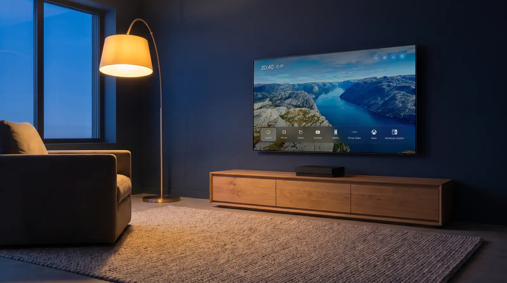
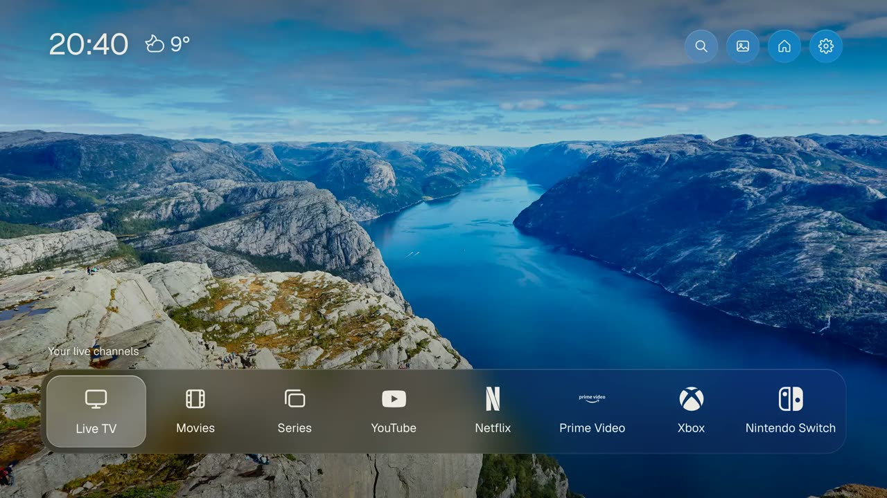
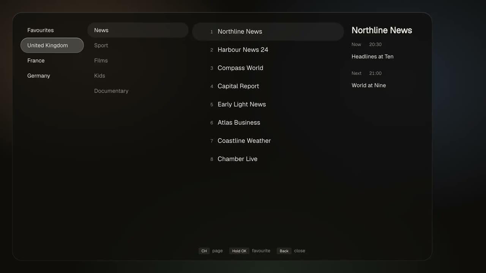
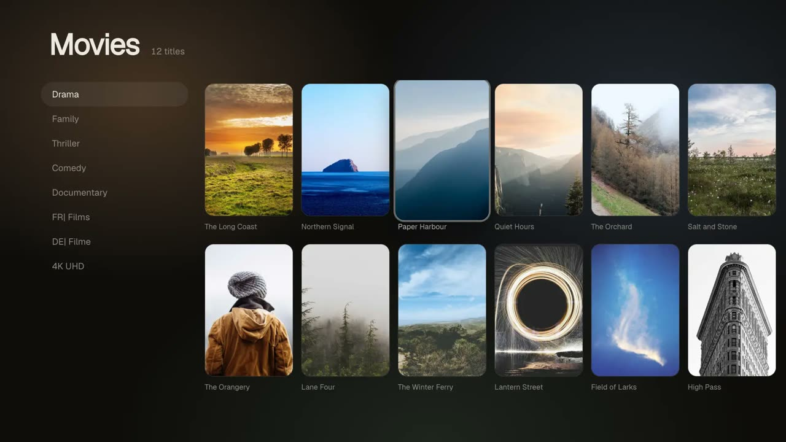
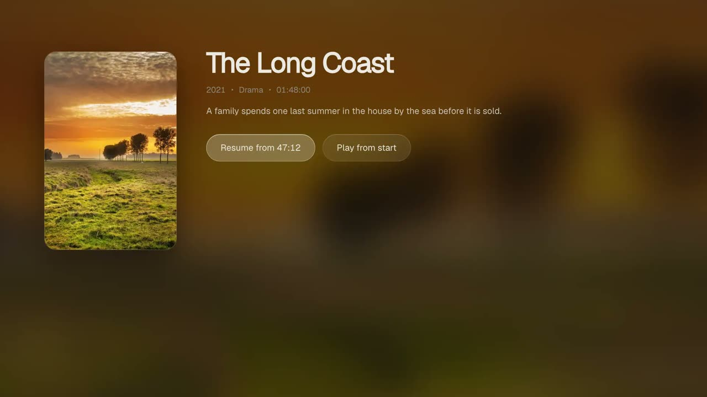

  <a href="https://opencream.tv">
    <picture>
      <source media="(prefers-color-scheme: dark)" srcset="brand/logos/opencream-tv-logo-dark.svg">
      
    </picture>
  </a>

<h3 align="center">A calm home screen for Samsung TVs, with your own IPTV service built in.</h3>

  <a href="https://opencream.tv"><b>Website</b></a> ·
  <a href="https://opencream.tv/install">Install guide</a> ·
  <a href="https://opencream.tv/demo">Try it in your browser</a> ·
  <a href="https://opencream.tv/compatibility">Compatibility</a> ·
  <a href="https://opencream.tv/faq">FAQ</a>

  
  
  

  

You turn on the TV and get one quiet screen: the time, the weather, the apps you actually use
(YouTube, Netflix, Disney+, whatever is installed, in your order) and tiles for your consoles.
Live TV, films and series from your IPTV subscription sit on the same screen instead of in a
separate app. Nothing on it is an ad.

**opencream TV includes no channels.** It plays the Xtream Codes service you already subscribe to.
See [DISCLAIMER.md](DISCLAIMER.md).

## Screens

| | |
|---|---|
|  |  |
| **Home.** Your apps and HDMI inputs, in your order. | **Live TV.** Channel guide, favorites (hold OK), CH up/down. |
|  |  |
| **Films and series.** Your provider's catalog, with posters. | **Resume.** Pick up where you stopped. |

The channels and films in these screens are fictional sample content. Want to click around
yourself? The [browser demo](https://opencream.tv/demo) runs the real app with the same samples.

## What it does

- Home screen with the apps installed on your TV, in the order you choose, plus HDMI tiles for consoles
- Live TV with a channel guide, favorites (hold OK) and automatic switching to a backup server
- Films and series with resume, audio and subtitle choice, and the same title in other languages or in 4K
- One search across channels, films, series and what is on in the program guide
- Countries and languages you pick; adult groups behind a PIN
- Uses the TV's own video player, so channels start in about a second

## Requirements

- A Samsung TV from 2019 or newer (Tizen 5.0+). Older TVs refuse the install.
  [Check your model](https://opencream.tv/compatibility).
- An IPTV subscription with an Xtream Codes login (server, username, password). M3U playlists are
  planned.
- A computer on the same home network for the one-time install.

## Install

Samsung's store only installs its own catalog, so the app goes on once from a computer. It takes
about 20 minutes the first time.

1. Turn on Developer Mode on the TV (Apps, then type 1 2 3 4 5 on the remote).
2. Install [Apps2Samsung](https://github.com/PatrickSt1991/Samsung-Jellyfin-Installer), a free
   community installer for Windows, macOS and Linux.
3. Pick opencream TV in its list and press install.

The full guide with screenshots is at **[opencream.tv/install](https://opencream.tv/install)**
(also in [INSTALL.md](INSTALL.md)). If you use Claude Code or Codex, you can ask it to do the
install: [AGENTS.md](AGENTS.md) is written for that.

## Privacy

Your IPTV login is stored on the TV. The weather uses the town you type (sent to Open-Meteo); the
TV's internet address goes to ip-api.com only if you ask the app to find your town that way. The
app has no account, no tracking and no analytics. Details:
[opencream.tv/privacy](https://opencream.tv/privacy).

## Status and compatibility

Built for one living room first and now open to everyone. Tested on a 2023 QN90C (Tizen 8).
If you run it on another model, please
[send a compatibility report](https://github.com/opencream-ai/opencream-tv/issues/new?template=compatibility.yml).
It takes two minutes and helps the next owner of the same TV. Reports are listed on
[opencream.tv/compatibility](https://opencream.tv/compatibility).

## Support the project

opencream TV is free and stays free. If it made your evenings calmer, you can
[buy Matthias a coffee](https://opencream.tv/support). Starring this repository helps too.

## Contributing

Bug reports and compatibility reports are welcome as issues. The app is plain ES5 JavaScript so it
runs on the Chromium 63 engine of 2019 TVs. Build and test notes:
[docs/DEVELOPMENT.md](docs/DEVELOPMENT.md).

## License

GPL-3.0 ([LICENSE](LICENSE)). The names "opencream", "opencream TV" and "opencream.tv" and the logos are not part
of the license ([TRADEMARK.md](TRADEMARK.md)). Fonts, icons and photos:
[THIRD_PARTY.md](THIRD_PARTY.md). The living-room scene at the top is AI-generated; the screen on
the TV in it is a real capture of the app.

opencream TV is an independent app, not affiliated with or endorsed by Samsung.

---

  Made by <a href="https://opencream.ai"><b>opencream.ai</b></a>, a small software company in France
  that builds AI and apps for European businesses.
   
  <a href="https://opencream.tv">opencream.tv</a> · <a href="https://opencream.ai">opencream.ai</a>

